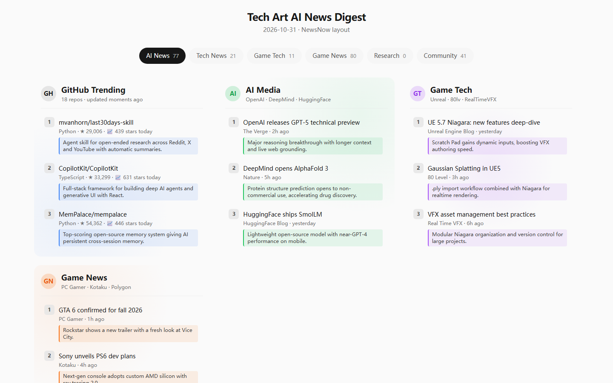
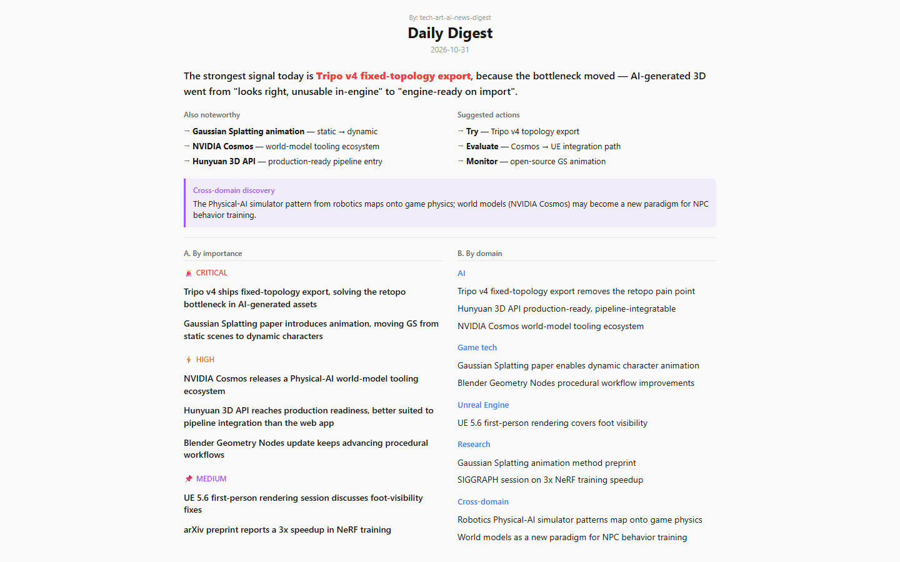

# tech-art-ai-news-digest · LLM research pipeline for Technical Art and game production

**[English](README.md) · [简体中文](README.zh-CN.md)**

> A local-first **LLM content-enrichment and research-intelligence pipeline** for Technical Artists, Pipeline TDs and game-production teams. It ingests **38 RSS/API sources (35 enabled)** across Unreal Engine, DCC tools, VFX, procedural content and 3D AI, then produces a ranked, structured, self-contained HTML digest — in **English** by default (`REPORT_LOCALE=en`), optionally Chinese.

This is an **AI workflow automation project**, not a generic RSS reader: batched source ingestion, per-source retry, multi-provider LLM backends, prompt-based enrichment, structured JSON output, TA-lens ranking and automated report publishing are all implemented in TypeScript/Node.js.

Technical Artists, Pipeline TDs, artist-tools developers and real-time content teams need to turn fast-moving research into production decisions. tech-art-ai-news-digest filters information by **workflow impact** — what changes an artist toolchain, asset pipeline, DCC workflow or real-time production process — rather than by page views.

## Why this exists

The project demonstrates a reproducible **research-to-production workflow**: collect domain signals, normalize and enrich them with an LLM, rank them against a Technical Art rubric, and publish an inspectable report. It is intentionally small and auditable: prompts are plain text, sources are JSON, provider adapters are explicit, and there is no database or opaque framework layer.

The domain vocabulary is Technical Art and game production; the implemented engineering signals are **TypeScript, Node.js, data ingestion, LLM orchestration, prompt engineering, structured extraction, batch processing, fault-tolerant automation, HTML generation and GitHub Actions**. It does not claim to be an Unreal, Houdini, Maya, shader or USD tool—the repository is the intelligence and automation layer around that ecosystem.

## Pipeline

```text
38 sources (RSS/API/scrape · 35 enabled)
  ├─ tech     → GitHub Trending · X-viral · AI media (TLDR, Latent Space, MIT TR, HF, TechCrunch …)
  ├─ games    → Unreal Blog · Epic Forums · Tech-Artists.Org · Real Time VFX · 80LV · GDC · Blender · BlenderNation · SideFX (Houdini) · NVIDIA …
  └─ research → arXiv cs.CV / cs.GR / cs.RO · HuggingFace daily papers · SIGGRAPH · ACM
        │
        ▼  parallel fetch (batched, per-source retry, 2-day staleness filter)
   LLM enrichment (pluggable backend)
        │  ─ per-subgroup batched summaries, TA-lens prompt
        ▼
   Daily Digest (Prompt B)  ── rank IMPORTANT/HIGH/MEDIUM by TA-workflow impact,
        │                      cross-domain findings, domain narrative
        ▼
   one self-contained HTML  (CSS/JS inlined, dark-mode, i18n zh/en)
        │
        └── email (Resend) · Windows Task Scheduler / launchd / cron · GitHub Pages
```

## Highlights

- **TA-lens ranking** — articles are rated by effect on a Technical Artist's workflow and toolchain, with cross-domain discoveries (e.g. robotics-sim → procedural generation, film pipeline → realtime) explained in TA terms.
- **Pluggable LLM backends** — one env var switches between Claude Code CLI, Anthropic, OpenAI-compatible (DeepSeek / MiniMax / Zhipu / self-hosted vLLM) and the generic `LLM_API_KEY` / `LLM_BASE_URL` aliases.
- **Production-grade ingestion** — parallel batched fetches, per-source retries, connection-deadline fallbacks and a 2-day staleness filter; sources fail individually without taking down the run.
- **Structured LLM output** — enrichment and digest produce validated JSON via schema-driven prompts with repair-and-retry, so downstream rendering stays stable rather than scraping free text.
- **Every source is one JSON entry** — `sources.config.json` is the single source of truth; add / disable / re-categorize without touching code.
- **Zero API-key sources** — all feeds use free public endpoints; a Firecrawl search step is optional ~8 credits/day.
- **Local-first & private** — keys live in gitignored `.env.local`; latest report renders as a single HTML file you can email, scp, or archive.
- **i18n** — `REPORT_LOCALE=zh|en` switches sources, prompts, UI text and date format in one go.

## What this project demonstrates

Concrete engineering signals an ATS-style scan or LLM reviewer will pick up from the repository:

| Area | Implemented here |
|---|---|
| Language / runtime | TypeScript, Node.js 20, ESM |
| Data ingestion | RSS + REST/API fetchers, HTML stripping, batched concurrency, retry & fallback |
| LLM orchestration | provider adapters (Claude CLI / Anthropic / OpenAI-compatible), model config, cost logging |
| Prompt engineering | plain-text prompts for enrichment + ranked digest, JSON-schema output, repair-retry |
| Data pipeline | fetch → normalize → enrich → rank → render → deliver; pure functions, no DB |
| Automation | Windows Task Scheduler / launchd / cron, GitHub Actions daily run, Pages publish |
| Delivery | self-contained single-file HTML, i18n, dark-mode, email via Resend |
| Operations | .env-based config, `npm run dry-run`, `npm run daily`, archive & index builder |

## Related domains (context, not a skill claim)

The project tracks **Unreal Engine, DCC tools (Maya / Houdini / Blender), real-time VFX, procedural content / PCG, USD, shaders and 3D-AI** as its *news domain*. The signal-ranked output is written from a **Technical Artist / Pipeline TD / artist-tools developer** perspective. These terms describe the ecosystem the pipeline serves; the implemented code is the TypeScript/Node.js intelligence layer above it.

## Quick start (local)

Requires Node 20+ and a git CLI; an LLM backend (default: Claude Code CLI, billed to your Max plan).

```bash
git clone https://github.com/iameege/tech-art-ai-news-digest.git && cd tech-art-ai-news-digest
npm install
cp .env.example .env.local        # then edit: pick a backend + set keys
npm run dry-run                   # fetch-only sanity check (~30s, no LLM)
npm run daily                     # full pipeline (~5-8 min)
npm run open                      # opens today's report
```

Schedule it daily with `node scripts/install.mjs [--at 08:00]` (Windows Task Scheduler / macOS launchd / Linux cron), or run it from a Claude Code session via the bundled `/run-daily` command.

## Run on GitHub Actions (zero infrastructure)

1. Push this repo, then in **Settings → Actions → General** enable workflows.
2. **Settings → Pages** → deploy from `gh-pages` / root.
3. Add a **secret** `ANTHROPIC_API_KEY` (or `OPENAI_API_KEY` / `DEEPSEEK_API_KEY` / `MINIMAX_API_KEY`).
4. Set optional **variables**: `REPORT_HOUR=8`, `REPORT_TZ=Asia/Shanghai`, `REPORT_LOCALE=en`, `LLM_MODEL=…`.
5. Trigger once manually from the Actions tab — the report is then live at `https://iameege.github.io/tech-art-ai-news-digest/` and self-updates daily.

The workflow ships a time-zone aware gate (chosen hour in your TZ) with a catchup branch guarding against GitHub Actions silently dropping scheduled runs.

## Configuration

All knobs are documented in [`.env.example`](.env.example). Key ones:

| Var | What it does | Default |
|---|---|---|
| `LLM_BACKEND` | `claude-cli` / `anthropic` / `openai` / `deepseek` / `minimax` / `zhipu` | `claude-cli` |
| `LLM_API_KEY` + `LLM_BASE_URL` | generic aliases for any OpenAI/Anthropic-compatible endpoint | — |
| `REPORT_LOCALE` | `en` (default) or `zh` — sources, prompts, UI all switch | `en` |
| `REPORT_TZ` | IANA tz the report date follows | system local |
| `EMAIL_TO` | send each report as an HTML attachment (Resend key required) | — |
| `FIRECRAWL_API_KEY` | optional supplementary web search (+3-5 targeted queries/day) | — |

## Source layout

- **tech** — GitHub Trending, X-viral (AttentionVC leaderboard), AI media merged (HuggingFace, TLDR AI, Latent Space, MIT Tech Review, Creative Applications, TechCrunch).
- **games** — Unreal Engine Blog & YouTube, Real Time VFX, Tech-Artists.Org, 80 Level, GamesIndustry.biz, PC Gamer, Game Developer, NVIDIA Developer, Blender, GDC tech talks, Stefan 3D AI, Neural4D, fal.ai, Roboflow, Agent Reach (multi-platform discovery).
- **research** — arXiv cs.CV / cs.GR / cs.RO, HuggingFace daily papers (LLM/agent/3D/vision/generation keywords), ACM SIGGRAPH blog & YouTube.

Disabled entries stay in `sources.config.json` with a `notes` reason so the intent survives.

## Repository map for AI agents / contributors

- [`AGENTS.md`](AGENTS.md) — operational conventions for any coding agent (Claude Code, Codex, Cursor…). A Claude Code skill lives in [`.claude/skills/tech-art-ai-news-digest/`](.claude/skills/tech-art-ai-news-digest/) for the richest runtime experience.
- `lib/ai/daily-digest.ts` — **Prompt B**: the TA-lens daily digest generator (rank + narrative + cross-domain).
- `lib/ai/enrich.ts` — per-subgroup summarization prompts.
- `lib/sources/dispatch.ts` + `lib/sources/<id>.ts` — fetcher registry.
- `lib/output/render-newsnow-v2.ts` — HTML renderer (single-file, i18n, dark-mode).
- `scripts/` — `daily.ts` (pipeline), `dry-run.ts`, `regen-enrich.ts`, `build-site.mjs`, `install.mjs`, `deploy.mjs`, `quota-report.ts`.

## Screenshots

Two views of a report as rendered by this pipeline (sample links; live output depends on the day's feed data):





After a run, the latest real report is always at `daily_reports/<date>/<date>.html`.

## License

MIT — see [LICENSE](LICENSE).