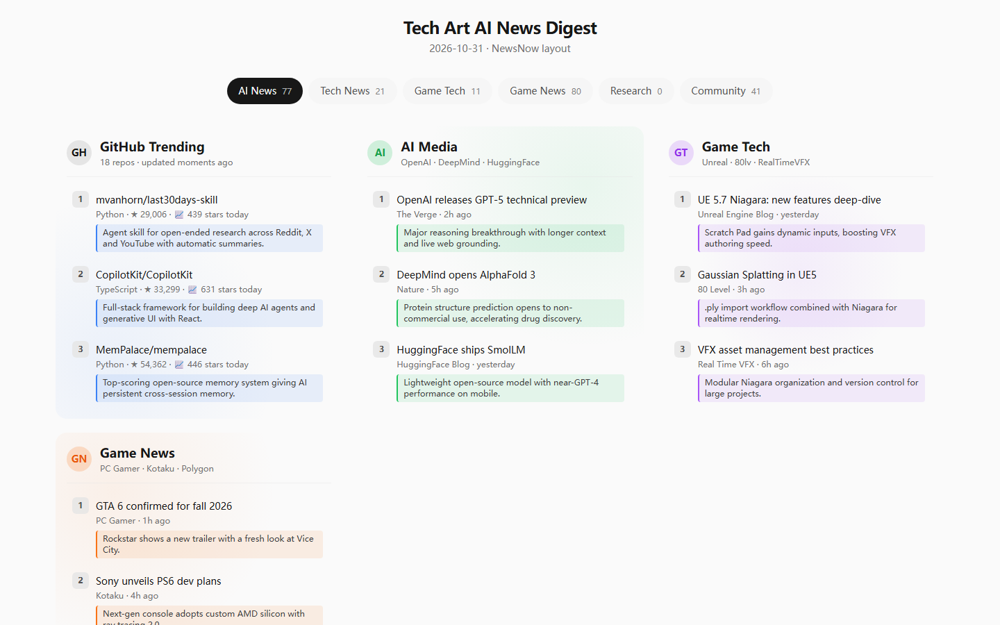
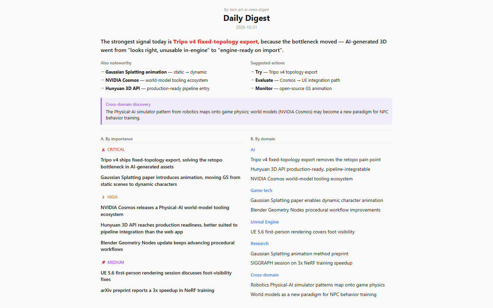

# tech-art-ai-news-digest · 面向技术美术与游戏制作的 LLM 研究管线

**[English](README.md) · [简体中文](README.zh-CN.md)**

> 一个**本地优先的 LLM 内容增强与研究情报管线**,面向技术美术 (Technical Artist)、管线技术美术 (Pipeline TD) 和游戏制作团队。它聚合 **38 个 RSS/API 源(35 个启用)**,覆盖 Unreal Engine、DCC 工具、VFX、程序化内容与 3D AI,然后产出一份经排序、结构化、自包含的 HTML 简报——默认输出**英文**(`REPORT_LOCALE=en`),可切换为中文。

这是一个 **AI 工作流自动化项目**,不是通用的 RSS 阅读器:批量源抓取、每源重试、多后端 LLM、基于 Prompt 的增强、结构化 JSON 输出、面向 TA 视角的排序、自动化报告发布,全部用 TypeScript/Node.js 实现。

技术美术、管线 TD、美术工具开发者和实时内容团队需要把快速变化的研究转成生产决策。tech-art-ai-news-digest 按**工作流影响**过滤信息——什么会改变美术工具链、资产管线、DCC 工作流或实时生产流程——而不是按浏览量。

## 为什么做这个项目

该项目演示了一条可复现的**从研究到生产的工作流**:收集领域信号,用 LLM 规范化并增强,按技术美术准则排序,再发布一份可检查的报告。它刻意保持小而可审计:Prompt 是纯文本,源是 JSON,各 provider 适配器明确,没有数据库或不透明的框架层。

领域词汇是技术美术与游戏生产;已实现的工程信号是 **TypeScript、Node.js、数据采集、LLM 编排、Prompt 工程、结构化抽取、批处理、容错自动化、HTML 生成与 GitHub Actions**。它不自称是 Unreal、Houdini、Maya、Shader 或 USD 工具——这个仓库是围绕该生态的智能与自动化层。

## 管线

```text
38 sources (RSS/API/scrape · 35 enabled)
  ├─ tech     → GitHub Trending · X-viral · AI 媒体 (TLDR, Latent Space, MIT TR, HF, TechCrunch …)
  ├─ games    → Unreal Blog · Epic Forums · Tech-Artists.Org · Real Time VFX · 80LV · GDC · Blender · BlenderNation · SideFX (Houdini) · NVIDIA …
  └─ research → arXiv cs.CV / cs.GR / cs.RO · HuggingFace daily papers · SIGGRAPH · ACM
        │
        ▼  并行抓取(分批、每源重试、2 天陈旧过滤)
   LLM 增强(可插拔后端)
        │  ─ 按子组批量摘要,TA 视角 Prompt
        ▼
   每日简报 (Prompt B)  ── 按 TA 工作流影响排序
        │                      IMPORTANT/HIGH/MEDIUM,跨领域发现,领域叙事
        ▼
   单个自包含 HTML  (内联 CSS/JS、深色模式、i18n 中英)
        │
        └── 邮件 (Resend) · Windows 任务计划程序 / launchd / cron · GitHub Pages
```

## 亮点

- **TA 视角排序** — 文章按对技术美术工作流与工具链的影响评分,跨领域发现(如机器人仿真→程序化生成、影视管线→实时)会用 TA 的语言解释。
- **可插拔 LLM 后端** — 一个环境变量切换 Claude Code CLI、Anthropic、OpenAI 兼容(DeepSeek / MiniMax / Zhipu / 自托管 vLLM)以及通用 `LLM_API_KEY` / `LLM_BASE_URL` 别名。
- **生产级采集** — 并行分批抓取、每源重试、连接超时兜底、2 天陈旧过滤;单个源失败不会拖垮整个运行。
- **结构化 LLM 输出** — 增强与简报通过 Schema 驱动 Prompt 产出经校验的 JSON,带修复-重试,下游渲染始终稳定,而不是解析自由文本。
- **每个源就是一条 JSON** — `sources.config.json` 是唯一事实来源;无需触碰代码即可增删/禁用/重新分类。
- **零 API-key 源** — 所有 Feed 使用免费公共端点;可选的 Firecrawl 搜索步骤约 8 credits/天。
- **本地优先且私有** — 密钥存放在被 gitignore 的 `.env.local`;最新简报渲染为单个 HTML 文件,可邮件、scp 或归档。
- **i18n** — `REPORT_LOCALE=en|zh` 一键切换源集、Prompt、UI 文本与日期格式(默认英文)。

## 这个项目展示了什么

ATS 式扫描或 LLM 审查者会从仓库读到的具体工程信号:

| 领域 | 这里的实现 |
|---|---|
| 语言 / 运行时 | TypeScript、Node.js 20、ESM |
| 数据采集 | RSS + REST/API 抓取器、HTML 剥离、批量并发、重试与兜底 |
| LLM 编排 | Provider 适配器(Claude CLI / Anthropic / OpenAI 兼容)、模型配置、成本记录 |
| Prompt 工程 | 增强 + 排序简报的纯文本 Prompt、JSON-Schema 输出、修复-重试 |
| 数据管线 | 抓取 → 规范化 → 增强 → 排序 → 渲染 → 交付;纯函数,无数据库 |
| 自动化 | Windows 任务计划 / launchd / cron、GitHub Actions 每日运行、Pages 发布 |
| 交付 | 自包含单文件 HTML、i18n、深色模式、Resend 邮件 |
| 运维 | 基于 .env 的配置、`npm run dry-run`、`npm run daily`、归档与索引构建 |

## 相关领域(语境,不是技能声明)

项目把 **Unreal Engine、DCC 工具(Maya / Houdini / Blender)、实时 VFX、程序化内容 / PCG、USD、Shader 与 3D AI** 作为*新闻领域*来追踪。排序输出站在**技术美术 / 管线 TD / 美术工具开发者**视角写作。这些术语描述的是该管线所服务的生态;实际代码是浮在其上的 TypeScript/Node.js 智能层。

## 本地快速开始

需要 Node 20+ 和 git CLI;需要一个 LLM 后端(默认:Claude Code CLI,计入 Max 订阅)。

```bash
git clone https://github.com/<you>/tech-art-ai-news-digest.git && cd tech-art-ai-news-digest
npm install
cp .env.example .env.local        # 然后编辑:选一个后端 + 填 key
npm run dry-run                   # 仅抓取 sanity check(~30s,不调 LLM)
npm run daily                     # 全量管线(~5-8 min)
npm run open                      # 打开今天的简报
```

用 `node scripts/install.mjs [--at 08:00]` 设置每日定时(Windows 任务计划 / macOS launchd / Linux cron),或通过内置的 `/run-daily` 命令从 Claude Code 会话运行。

## 在 GitHub Actions 上运行(零基础设施)

1. Push 仓库,然后在 **Settings → Actions → General** 启用 workflows。
2. **Settings → Pages** → 从 `gh-pages` / root 部署。
3. 添加 **secret** `ANTHROPIC_API_KEY`(或 `OPENAI_API_KEY` / `DEEPSEEK_API_KEY` / `MINIMAX_API_KEY`)。
4. 设置可选 **variables**:`REPORT_HOUR=8`、`REPORT_TZ=Asia/Shanghai`、`REPORT_LOCALE=en`、`LLM_MODEL=…`。
5. 从 Actions 标签页手动触发一次——简报随后发布在 `https://<you>.github.io/tech-art-ai-news-digest/` 并每日自动更新。

工作流内置时区感知闸门(在你所在时区的小时触发),并有 catchup 分支防止 GitHub Actions 静默丢弃定时运行。

## 配置

所有旋钮都记录在 [`.env.example`](.env.example)。关键项:

| 变量 | 作用 | 默认 |
|---|---|---|
| `LLM_BACKEND` | `claude-cli` / `anthropic` / `openai` / `deepseek` / `minimax` / `zhipu` | `claude-cli` |
| `LLM_API_KEY` + `LLM_BASE_URL` | 指向任意 OpenAI/Anthropic 兼容端点的通用别名 | — |
| `REPORT_LOCALE` | `en`(默认)或 `zh` — 源、Prompt、UI 全部切换 | `en` |
| `REPORT_TZ` | 简报日期跟随的 IANA 时区 | 系统本地 |
| `EMAIL_TO` | 把每份简报作为 HTML 附件发送(需 Resend key) | — |
| `FIRECRAWL_API_KEY` | 可选补充网络搜索(+3-5 条定向查询/天) | — |

## 源布局

- **tech** — GitHub Trending、X-viral(AttentionVC 榜)、AI 媒体合并(HuggingFace、TLDR AI、Latent Space、MIT Tech Review、Creative Applications、TechCrunch)。
- **games** — Unreal Engine 官方博客与 YouTube、Epic 开发者社区论坛、Real Time VFX、Tech-Artists.Org、80 Level、GDC 技术演讲、Blender、BlenderNation、SideFX (Houdini) 官方 YouTube、NVIDIA Developer、Neural4D、fal.ai、Roboflow、Agent Reach(多平台发现)等。
- **research** — arXiv cs.CV / cs.GR / cs.RO、HuggingFace 每日论文(LLM/agent/3D/vision/generation 关键词)、ACM SIGGRAPH 博客与 YouTube。

被禁用的条目仍在 `sources.config.json` 中并带 `notes` 原因,意图得以保留。

## 面向 AI 代理 / 贡献者的仓库地图

- [`AGENTS.md`](AGENTS.md) — 面向任意编码代理(Claude Code、Codex、Cursor…)的操作约定。Claude Code skill 位于 [`.claude/skills/tech-art-ai-news-digest/`](.claude/skills/tech-art-ai-news-digest/),提供最丰富的运行时体验。
- `lib/ai/daily-digest.ts` — **Prompt B**:TA 视角每日简报生成器(排序 + 叙事 + 跨领域)。
- `lib/ai/enrich.ts` — 按子组摘要 Prompt。
- `lib/sources/dispatch.ts` + `lib/sources/<id>.ts` — 抓取器注册表。
- `lib/output/render-newsnow-v2.ts` — HTML 渲染器(单文件、i18n、深色模式)。
- `scripts/` — `daily.ts`(管线)、`dry-run.ts`、`regen-enrich.ts`、`build-site.mjs`、`install.mjs`、`deploy.mjs`、`quota-report.ts`。

## 截图

管线产出报告的两个视图(示例链接;实际输出取决于当天的数据):





运行后最新的真实简报始终在 `daily_reports/<date>/<date>.html`。

## License

MIT — 见 [LICENSE](LICENSE)。